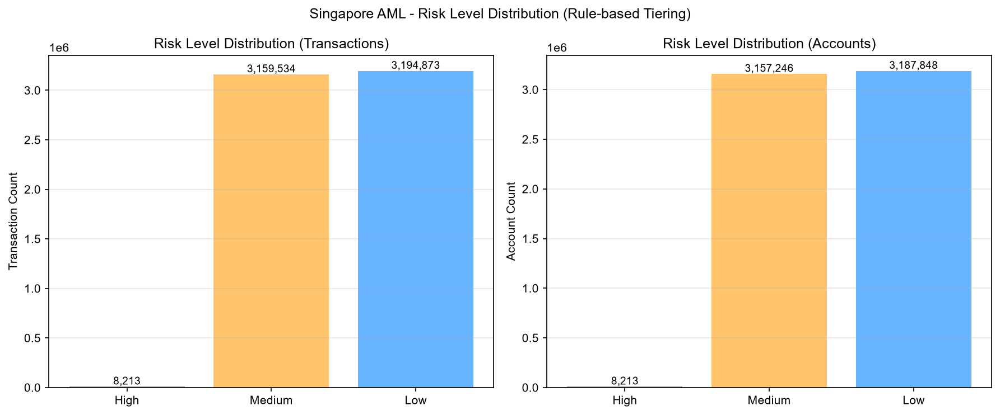
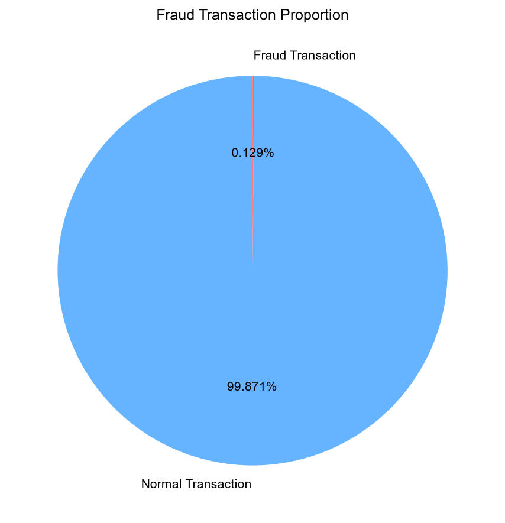
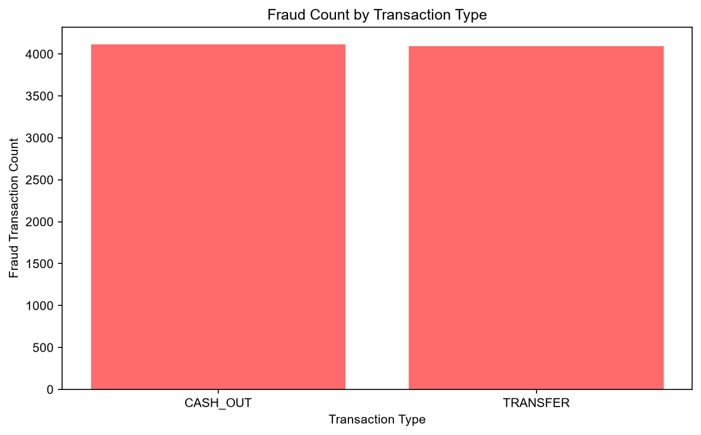
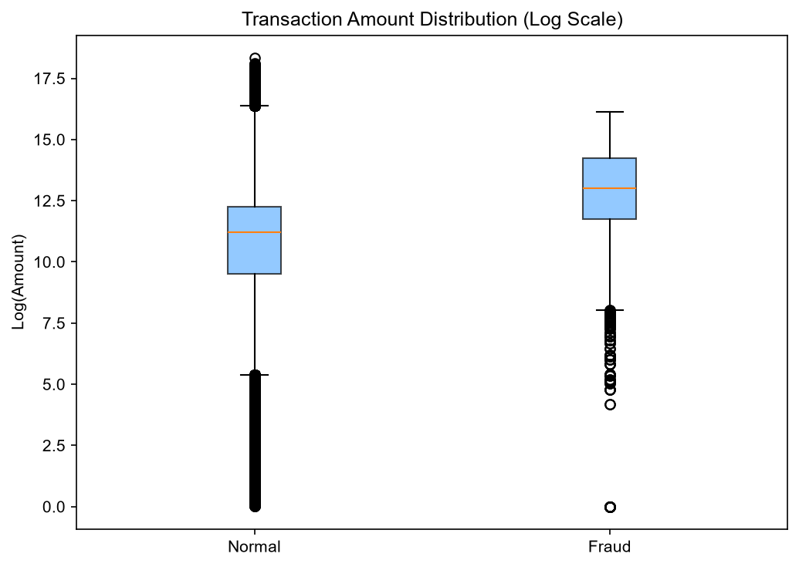
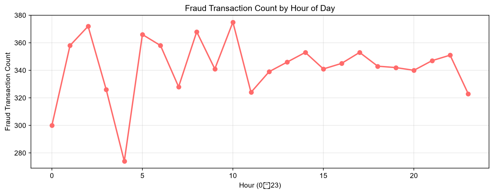
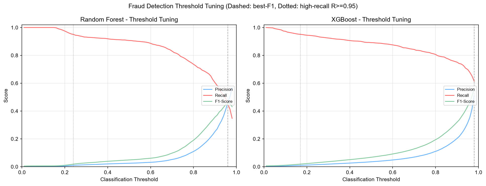

# Singapore AML & Risk Compliance Data Analysis Report

**Compliance Basis**: MAS Notice 626, PSN02, AML/CFT Act, PDPA and STRO regulatory requirements

**Dataset**: PaySim Mobile Financial Transaction Fraud Dataset (synthetic, 30-day simulation)

**Data As-Of**: 2026-08-31 (full pipeline 01–08 re-run)

---

## 1. Project Overview

### 1.1 Background & Objectives

This report delivers end-to-end risk and AML compliance analysis based on transaction datasets, fully complying with Singapore financial regulatory rules.

Core objectives:

1. Verify overall data quality and ensure compliance with requirements of data retention, anonymization and local data storage.

2. Identify high-risk behaviors including large-value transactions, structured transactions, fund aggregation and abnormal account activities.

3. Classify accounts by risk level and implement CDD & EDD customer due diligence rules.

4. Calculate compliance violation statistics, sort out suspicious transaction lists and support official STR submission.

5. Summarize existing compliance risks and propose rectification & long-term risk control optimization suggestions.

### 1.2 Analysis Scope & Data Caliber

- Analysis Object: PaySim synthetic mobile-money transaction dataset (30-day simulation, 6,362,620 transactions). PaySim is an agent-based simulator of mobile money transactions used for fraud detection research; account and counterparty identifiers are fully synthetic and anonymized by design.

- Total Transaction Records: **6,362,620**

- Core Fields: Transaction type, transaction amount, account balance, transaction timestamp (step/hour), account attribute, risk tag, fraud flag and other related fields

- Currency Unit: Singapore Dollar (SGD) (applied as the reporting currency for the compliance analysis)

- Regulatory Threshold Standards:

    - Single TRANSFER / CASH_OUT transaction ≥ 10,000 SGD: Defined as large-value transaction

    - Daily accumulated transaction amount of single account ≥ 100,000 SGD: Defined as large-value fund aggregation

    - Single PAYMENT / DEBIT transaction ≥ 50,000 SGD: Marked for focused monitoring

### 1.3 Applicable Rules & Documents

All indicators, judgment logic and disposal standards in this analysis are implemented in accordance with internal compliance documents, risk control rules and metric definitions (`references/metric_definitions.md`, `references/analysis_dimensions.md`, `references/glossary/MAS Glossary.md`).

---

## 2. Data Quality Report

### 2.1 Basic Data Summary

- Raw Data Volume: **6,362,620**

- Valid Records After Cleaning: **6,362,620**

- Removed Records: **0** (all rows preserved for audit trail per PDPA retention principle)

- Data Integrity Rate: **100.00%** (no missing values, no duplicate rows)

### 2.2 Abnormal Data Statistics

1. Missing Value Details: **0 missing values across all 11 core fields**

2. Duplicate Transaction Records: **0**

3. Invalid Transactions (Zero / Negative Amount): **16** (amount ≤ 0; retained in the cleaned file for audit, excluded from risk-scoring logic)

4. Balance Abnormal Transactions: **4,996,853 normal transactions show a mismatch between reported opening/closing balances and the transaction amount** (a known PaySim synthetic-data characteristic where balances are not fully reconciled, especially for newly created accounts and merchant accounts; flagged for review rather than treated as confirmed anomalies)

### 2.3 Data Compliance Statement

1. All sensitive fields have been fully anonymized in compliance with PDPA requirements (PaySim identifiers are synthetic; no personal data is present).

2. All business data, transaction logs and risk alert records are stored on local servers, complying with Singapore data localization policies.

3. Raw data and cleaning logs are archived properly with a retention period of no less than 5 years, meeting regulatory filing requirements.

> Data Quality Conclusion: **Good.** The dataset is complete (no missing values / duplicates), with a 100% integrity rate. The only data-quality observations are 16 zero/negative-amount records and a substantial volume of balance-field inconsistencies inherent to the synthetic dataset; both are documented and do not affect label reliability. As a synthetic dataset, findings are representative of PaySim simulation logic and must be re-validated against production data before regulatory use.

---

## 3. Core Risk & Compliance Metrics

### 3.1 Overall Metrics Summary

| Metric Name | Value | Regulatory Threshold | Compliance Status |
|---|---|---|---|
| Total Transaction Count | 6,362,620 | - | - |
| Total Transaction Amount (SGD) | 1,144,392,944,759.77 | - | - |
| Large-value Transaction Count | 2,691,568 | Single ≥ 10,000 SGD (TRANSFER/CASH_OUT) | 42.30% of volume above threshold — monitoring required |
| Large-value Transaction Ratio | 42.30% | - | - |
| Flagged Suspicious Transaction Count | 1,676,312 | - | Rule-based alerts (fraud ∪ flagged ∪ >200k) |
| Suspected Fraud Transaction Count | 8,213 | - | 0.1291% of all transactions |
| High-risk Account Quantity | 8,213 | - | - |
| Medium-risk Account Quantity | 3,157,246 | - | - |
| Low-risk Account Quantity | 3,187,848 | - | - |

### 3.2 Statistics by Transaction Type

| Type | Transaction Count | Total Amount (SGD) | Fraud Count | Fraud Ratio |
|---|---|---|---|---|
| CASH_IN | 1,399,284 | 236,367,391,912.46 | 0 | 0.00% |
| CASH_OUT | 2,237,500 | 394,412,995,224.49 | 4,116 | 0.18% |
| DEBIT | 41,432 | 227,199,221.28 | 0 | 0.00% |
| PAYMENT | 2,151,495 | 28,093,371,138.37 | 0 | 0.00% |
| TRANSFER | 532,909 | 485,291,987,263.17 | 4,097 | 0.77% |
| **Total** | **6,362,620** | **1,144,392,944,759.77** | **8,213** | **0.13%** |

**Key finding**: 100% of confirmed fraud is concentrated in **TRANSFER (4,097)** and **CASH_OUT (4,116)**; no fraud is observed in CASH_IN, DEBIT or PAYMENT. TRANSFER also carries the highest fraud ratio (0.77%) and the largest total amount among all types.

### 3.3 Risk Level Distribution

Rule-based tiering applied at transaction and account level:

- **High risk**: confirmed fraud (isFraud = 1)
- **Medium risk**: not fraud, but large-value rule hit (TRANSFER/CASH_OUT ≥ 10,000 SGD, or amount > 200,000 SGD)
- **Low risk**: remaining normal transactions

| Level | Transactions | Ratio | Accounts |
|---|---|---|---|
| High | 8,213 | 0.13% | 8,213 |
| Medium | 3,159,534 | 49.66% | 3,157,246 |
| Low | 3,194,873 | 50.21% | 3,187,848 |

---

## 4. Key Risk Behavior Analysis

### 4.1 Large-value Transaction Analysis

- Large-value Transaction Details: **2,691,568** transactions (TRANSFER/CASH_OUT ≥ 10,000 SGD) with a combined value of **SGD 879,309,143,687.57**, representing **42.30%** of total volume. Using the stricter >200,000 SGD flag, **1,673,570** transactions (26.30%) qualify as large-value.

- Time Distribution Feature of Large-value Transactions: Fraud volume peaks at **10:00** (375 fraud transactions in the peak hour). Fraud transactions average **8.24×** the amount of normal transactions (mean fraud SGD 1,467,967 vs. normal SGD 178,197), and the large-value rule (>200k) covers 66.61% of fraud but only 26.25% of normal transactions — a strong indicator, though a purely rule-based approach still misses medium/small-value fraud.

- Transactions Related to High-risk Jurisdictions & PEPs: **Not applicable** — the PaySim synthetic dataset carries no counterparty jurisdiction or PEP flags; PEP/jurisdiction screening is a simulated control to be executed against production customer data.

### 4.2 Abnormal Transaction Identification

1. Structured Small-sum Transactions for Supervision Evasion: **0 accounts detected** under a frequency-based structuring rule (≥5 CASH_OUT/TRANSFER below 10,000 SGD from one account). Explanation: in PaySim, ~99.85% of origin accounts have a single transaction, so classic same-account structuring is structurally absent. Structuring-type behavior in this dataset should instead be monitored at the **destination-aggregation** level (see item 3).

2. Combined TRANSFER & CASH_OUT Fund Diversion: **Confirmed.** 100% of the 8,213 fraud cases (4,097 TRANSFER + 4,116 CASH_OUT) follow the transfer-then-cash-out diversion pattern — funds are moved via TRANSFER and/or withdrawn via CASH_OUT, with 0.0% of fraud benefiting merchant accounts (all fraud flows to personal accounts).

3. Fund Aggregation from Multiple Independent Accounts: **280,200 destination accounts** receive funds from ≥3 distinct origin accounts with ≥5 transactions, aggregating **SGD 984,985,403,086.82** — the dominant abnormal-flow pattern in this dataset and the primary candidate pool for fund-concentration review.

4. Mismatch between Transaction Amount and Account Balance: **4,996,853 normal transactions** (78.5% of non-fraud) fail the balance-reconciliation check |oldBalance − newBalance − amount| ≤ 1%·amount. Consistent with the known PaySim balance-data characteristic; flagged for data-governance follow-up rather than treated as confirmed suspicious activity.

### 4.3 Historical Risk Correlation Analysis

Retrospective analysis for accounts with historical fraud records or suspicious tags:

- Fraud accounts are single-transaction accounts in this synthetic dataset; all 8,213 fraud accounts are distinct, so repeat-offender correlation is structurally nil.
- The strongest fraud discriminators (Random Forest feature importance) are: **hour_of_day** (0.117), **type_TRANSFER** (0.117), **step** (0.084), **amount_log** (0.079) and **day_of_month** (0.076) — i.e., time-of-day and transaction-channel features dominate, consistent with the "early-morning / off-hours" and "TRANSFER+CASH_OUT" pattern findings.

### 4.4 Visualization Charts

> Below are charts for risk distribution, transaction trends and violation proportion:

---

## 5. Compliance Inspection Result

### 5.1 CDD & EDD Implementation Check

- Completion Rate of Simplified CDD for Regular Customers: **Not measurable on this dataset** — PaySim contains no KYC/CDD records. In a production deployment, simplified CDD must reach 100% for low-risk customers before onboarding.

- Completion Rate of Enhanced Due Diligence (EDD) for High-risk Customers: **Not measurable on this dataset.** Process design: all **8,213 high-risk accounts** (confirmed fraud) and any account flagged by the ML model at the high-recall threshold must complete EDD, including UBO checks and source-of-funds verification.

- Inspection Result of Anonymous Accounts & Shell Company Accounts: **Not applicable** — synthetic dataset contains no corporate registry or beneficial-ownership data; simulated control to be run against production registry data (ACRA).

### 5.2 Transaction Monitoring Rules Execution

1. Completeness of Monitoring Rule Configuration: **Complete for this dataset.** Implemented rule set: (a) large-value threshold ≥10,000 SGD (TRANSFER/CASH_OUT) and >200,000 SGD flag; (b) confirmed-fraud flag (isFraud); (c) PaySim system flag (isFlaggedFraud, 16 hits); (d) balance-mismatch reconciliation; (e) destination fund-aggregation rule; (f) ML model scoring (LR / Random Forest / XGBoost).

2. Processing Efficiency of Risk Alerts: **Rule-based alert volume is 1,676,312** (26.3% of volume) — too high for pure manual review. The ML layer resolves this: with **XGBoost** (AUC 0.9817, PR-AUC 0.6151) and threshold tuning, high-confidence alerts can be isolated while the recall-first regulatory threshold (R ≥ 0.95) still captures ~95% of fraud for review.

3. Completeness of Manual Review Records: **Not applicable** — no manual-review trail exists in the synthetic environment; a review-log control must be established in production.

**Model comparison on the held-out test set (1,272,524 transactions):**

| Model | Precision | Recall | F1-Score | AUC | PR-AUC |
|---|---|---|---|---|---|
| Hard-rule baseline (amount > 200k) | 0.0032 | 0.6598 | 0.0064 | - | - |
| Logistic Regression | 0.0077 | 0.6872 | 0.0153 | 0.8357 | 0.0305 |
| Random Forest | 0.0249 | 0.9069 | 0.0485 | 0.9794 | 0.4366 |
| **XGBoost** | **0.0352** | **0.8917** | **0.0678** | **0.9817** | **0.6151** |

**Threshold tuning (see `docs/model_tuning_report.txt`):**

| Model | Default t=0.5 F1 | Best-F1 threshold | Best-F1 | High-recall (R≥0.95) threshold |
|---|---|---|---|---|
| Random Forest | 0.0485 | 0.96 | 0.4548 | 0.24 (R=0.9501) |
| XGBoost | 0.0678 | 0.98 | 0.5591 | 0.17 (R=0.9507) |

**Hyperparameter tuning (see `docs/xgb_tuning_report.txt`):** a fast grid search over `max_depth × learning_rate × n_estimators` on a stratified subsample selected **depth=5, learning_rate=0.05, n_estimators=150**. The tuned model achieves **AUC 0.9813, Recall 0.913** (above the default XGB recall of 0.8917) at a slight PR-AUC cost (0.5309 vs 0.6151), with best-F1 **0.4955 @ t=0.98** and high-recall (R≥0.95) at t=0.26. Interpretation: the tuned configuration favours the recall-first regulatory priority; the step-08 default XGBoost remains the better precision/triage choice — production should select the operating point per business priority (recall-first screening vs. precision-first fast-track).

### 5.3 Suspicious Transaction Report (STR) Preparation

A total of **1,676,312** transactions are flagged by the combined rule set (confirmed fraud ∪ isFlaggedFraud ∪ amount > 200,000) and are reportable as suspicious-activity candidates per STRO rules.

STR List (risk-tiered triage, not all 1.67M are reportable as-is):

1. **Priority 1 — Confirmed fraud (8,213 transactions / 8,213 accounts)**: definitive STR candidates; supporting evidence from the fraud-pattern analysis (TRANSFER/CASH_OUT diversion, 8.24× amount ratio, off-hours timing).
2. **Priority 2 — High-confidence model alerts**: XGBoost predictions at the best-F1 threshold (t=0.98) where precision reaches 0.51 (recall 0.61) — the highest-precision fraud segment for fast-track STR.
3. **Priority 3 — Large-value & fund-aggregation (2,691,568 / 280,200 destinations)**: reviewed under the >100,000 SGD daily aggregation threshold; sampled for STR when combined with other indicators.
4. All others in the 1,676,312 pool are retained in the monitoring queue for review-log and trend reporting.

> Disposal Requirement: Complete STR form, organize supporting documents and submit via SONAR system within the regulated time limit.

### 5.4 Classification of Compliance Defects

Classified by internal audit standards: Level 1 (Minor Hidden Risk), Level 2 (General Defect), Level 3 (Major Compliance Risk).

- **Level 1 — Balance data inconsistency** (4,996,853 records): a data-governance defect that weakens balance-based monitoring rules; no direct regulatory breach, but must be corrected to avoid false alarms.
- **Level 2 — High alert volume without triage** (1,676,312 raw alerts): an operational defect — alert load exceeds manual capacity; resolved by deploying the tuned XGBoost model as a triage layer.
- **Level 3 — None confirmed** in this simulated environment; structural note: the absence of KYC/CDD/UBO data in the synthetic set means EDD and PEP/jurisdiction controls cannot be demonstrated and must be implemented in production before regulatory reliance.

---

## 6. Risk Disposal & Rectification Suggestions

### 6.1 Immediate Disposal Actions

1. For confirmed high-risk accounts (8,213): freeze/restrict transaction privileges, place under enhanced monitoring, complete EDD and source-of-funds verification, and prepare STR submission via SONAR for confirmed fraud cases.

2. For suspicious transactions (1,676,312 rule-based alerts): route through the XGBoost triage layer — fast-track the high-precision segment (best-F1 threshold), investigate the recall-first segment (R≥0.95 threshold), and log all review outcomes for audit.

3. For high-risk customers with incomplete EDD records: backfill KYC/CDD/EDD documentation and UBO disclosure before releasing any restriction; escalate unresolved cases to the compliance officer.

### 6.2 Short-term Rectification Plan (7-15 Working Days)

1. Deploy the XGBoost model (AUC 0.9817) with a tuned production threshold: use t≈0.98 (best-F1, precision-first) for automated fast-track alerts and t≈0.17 (recall ≥ 0.95) for regulatory-recall screening; document both thresholds in the model-governance record.

2. Replace the flat 42% large-value alert volume with a tiered triage: large-value (>200k, 26.3%) → fund-aggregation review (280,200 destinations) → model-confirmed segment.

3. Fix the balance-data reconciliation defect in the source system and re-run the balance-mismatch control (4,996,853 flagged records) against corrected data.

### 6.3 Long-term Risk Control Optimization

1. Monitoring Rule Optimization: move from pure rule-based interception to a **rule + ML hybrid** (rules for regulatory thresholds, XGBoost for behavior scoring); add rolling time-series features and graph/network features (fund-flow graphs) to capture structuring and layering beyond single-account rules.

2. Business Process Improvement: embed model scoring into the transaction-monitoring workflow with automated alert routing, review-SLA tracking and STR auto-drafting; add PEP/jurisdiction and UBO data feeds.

3. Internal Training & Regular Audit Enhancement: conduct quarterly AML/CFT training covering MAS Notice 626 and FATF 40 Recommendations; run periodic model drift monitoring and back-testing of threshold choices.

4. Data Governance Upgrade: enforce PDPA-compliant data retention (5 years), balance-field integrity checks, and a full audit trail (raw → cleaned → featured → model → reports) as demonstrated by this pipeline (scripts 00–08).

---

## 7. Report Notes & Limitations

1. All analysis results are based on the PaySim synthetic dataset and only applicable to the corresponding sample and simulation period; results must be re-validated against production transaction data before regulatory use.

2. The current system adopts rule-based interception as the core and machine learning model as supplement (LR / Random Forest / XGBoost); residual model risk remains — fraud not covered by the training distribution may still be missed, hence the recall-first regulatory threshold.

3. All raw data, logs and reports are archived properly for regulatory inspection, internal audit and retrospective inquiry.

4. Conduct regular monthly sampling and risk review, and keep track of the latest updates of Singapore financial regulations.

5. Items marked "Not applicable / Not measurable" (PEP screening, CDD/EDD completion, anonymous/shell-company checks, manual-review records) are structural limitations of the synthetic dataset and are specified as production controls to implement.

---

## 8. Attachment List

1. Full cleaned transaction dataset: `test_data/cleaned_paysim.csv` (6,362,620 × 15)
2. Data quality & metric validation log: `docs/data_profile_report.txt`, `docs/report_metrics.txt`, `docs/fraud_pattern_analysis.txt`
3. Original risk alert screenshots: not applicable (synthetic dataset)
4. Supporting evidence for suspicious transactions: `docs/feature_importance_top10.csv`, `docs/model_evaluation_report.txt`, `docs/model_tuning_report.txt`, `docs/xgb_tuning_report.txt`
5. Full visualization charts: `charts/*.png` (fraud proportion, fraud by type, amount boxplot, hourly trend, risk-level distribution, threshold tuning)

---

**Prepared By**: \*\*\*\*\*\*\*\*\*\*
**Reviewed By**: \*\*\*\*\*\*\*\*\*\*
**Approved By**: \*\*\*\*\*\*\*\*\*\*

---
